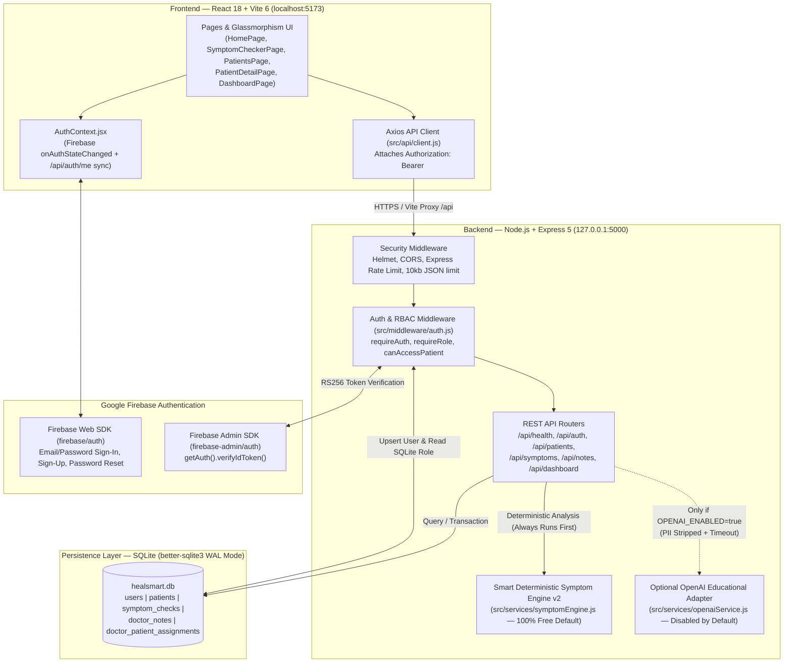
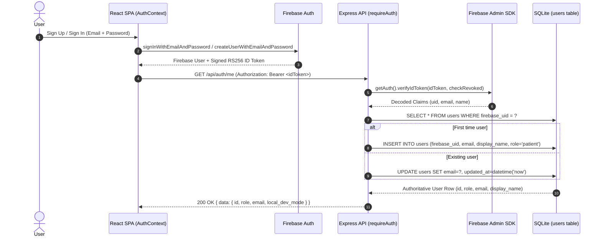
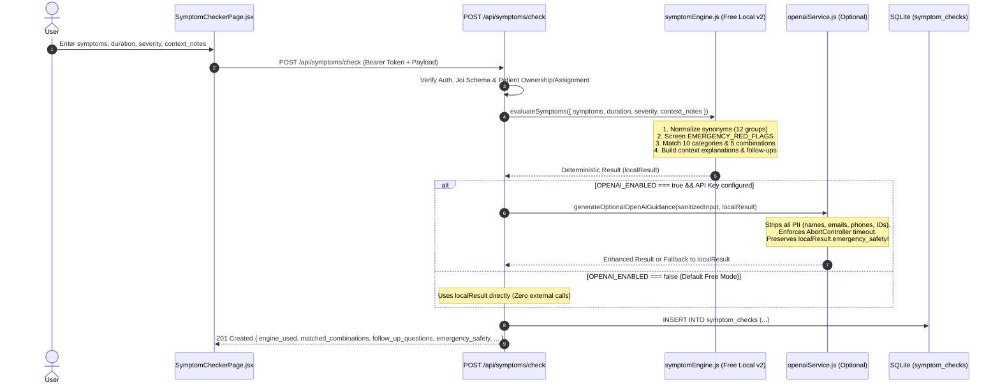

# HealSmartAI — System Architecture & Data Flow

This document describes the actual implemented architecture of **HealSmartAI** across the React + Vite frontend (`E:\HealSmartAI\frontend`), the Node.js + Express backend (`E:\HealSmartAI\backend`), Firebase Authentication, the SQLite database (`better-sqlite3`), and the Smart Symptom Engine v2.

---

## 1. High-Level System Architecture

---

## 2. Layered Architecture Breakdown

### 2.1 Frontend Layer (`E:\HealSmartAI\frontend\src`)
- **Entry & Routing (`main.jsx`, `App.jsx`):** Uses React Router v6 (`BrowserRouter` with `v7_startTransition` and `v7_relativeSplatPath` flags). Routes are wrapped in `<ProtectedRoute>` (requires authenticated user; `/dashboard` additionally requires `allowedRoles={['doctor']}`) or `<PublicOnlyRoute>` (`/login`, `/signup`, `/forgot-password`).
- **Authentication State (`context/AuthContext.jsx`):** Subscribes to Firebase `onAuthStateChanged`. Whenever a Firebase user session becomes active, `AuthContext` calls `GET /api/auth/me` to retrieve the user's authoritative SQLite profile (`id`, `firebase_uid`, `email`, `display_name`, `role`, `local_dev_mode`).
- **Centralized API Client (`api/client.js`):** Configured with `baseURL: import.meta.env.VITE_API_BASE_URL || '/api'`. A request interceptor calls `auth.currentUser.getIdToken()` and injects `Authorization: Bearer <token>`. A response interceptor unwraps `response.data` and normalizes backend error payloads into `{ status, message, details }`.

### 2.2 Backend Middleware Pipeline (`E:\HealSmartAI\backend\src`)
Every incoming request passes through the following pipeline in `backend/src/index.js`:
1. **`helmet()`:** Sets HTTP security headers.
2. **`cors()`:** Restricts cross-origin requests to `FRONTEND_URL` (supports comma-separated origins) and `http://localhost:4173`, allowing `Authorization` and `Content-Type` headers.
3. **`express-rate-limit` (`/api`):** Protects endpoints against brute-force or runaway loops (`RATE_LIMIT_MAX=2000` per 15 minutes in development; `200` in production).
4. **Body Parsers:** `express.json({ limit: '10kb' })` and `express.urlencoded({ extended: true, limit: '10kb' })` to prevent payload DoS attacks.
5. **Authentication & RBAC (`middleware/auth.js`):**
   - `requireAuth`: Extracts the Bearer token, verifies it via `verifyFirebaseToken()` in `config/firebaseAdmin.js` (`getAuth().verifyIdToken()`), and upserts the user record in SQLite `users`. New users always receive `role = 'patient'`. Attaches `req.user`.
   - `requireRole(...allowedRoles)`: Verifies `req.user.role` against allowed roles, returning `403 Forbidden` if unauthorized.
   - `canAccessPatient(db, user, patient)`: Returns `true` if `user.role === 'patient'` and `patient.owner_user_id === user.id`, OR if `user.role === 'doctor'` and either `patient.owner_user_id === user.id` or an assignment row exists in `doctor_patient_assignments`.
6. **Joi Request Validation (`middleware/validate.js`):** Validates and strips unknown fields on `req.body` or `req.query` (`stripUnknown: true`, `abortEarly: false`), returning structured `400 Bad Request` errors with field-level details.
7. **Centralized Error Handling (`middleware/errorHandler.js`):** Catches synchronous and asynchronous errors, maps SQLite constraint errors to `409 Conflict`, and suppresses stack traces when `NODE_ENV === 'production'`.

---

## 3. Core Data Flows

### 3.1 Authentication, Account Provisioning & RBAC Flow

### 3.2 Smart Symptom Assistant Evaluation Flow

### 3.3 Patient-Controlled Doctor Assignment & Immediate Revocation Flow

1. **Profile Creation (`PUT /api/patients/me`):** A signed-in patient creates their 1-to-1 health profile (`owner_user_id = req.user.id`).
2. **Doctor Discovery (`GET /api/auth/doctors`):** The patient opens their profile (`PatientDetailPage.jsx`), which fetches all verified users with `role = 'doctor'`.
3. **Granting Access (`POST /api/patients/:id/assign-doctor`):** The patient selects a doctor and clicks **Grant Access**. The backend verifies `patient.owner_user_id === req.user.id` and inserts `(doctor_user_id, patient_id)` into `doctor_patient_assignments`.
4. **Doctor Clinical Access:** The assigned doctor now sees the patient in `GET /api/patients`, `GET /api/dashboard/stats`, and `GET /api/dashboard/recent`, and can view/create clinical notes (`GET /api/notes`, `POST /api/notes`).
5. **Immediate Revocation (`DELETE /api/patients/:id/assign-doctor/:doctorUserId`):** When the patient clicks **Revoke Access**, the row in `doctor_patient_assignments` is deleted immediately. Any subsequent request by that doctor to view the patient, their symptom checks, or their notes immediately fails `canAccessPatient()` with `403 Forbidden`.
