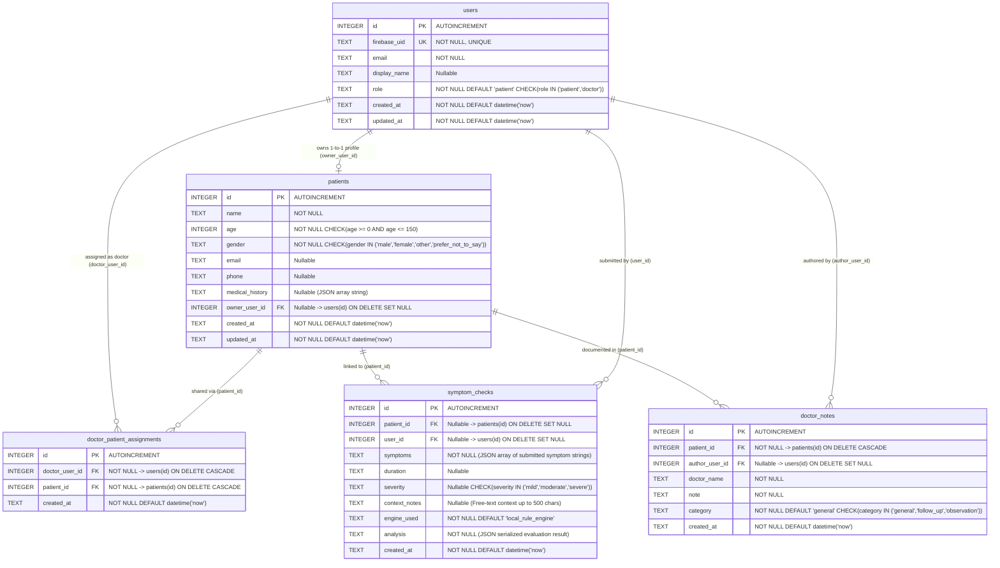

# HealSmartAI — Database Schema Reference

HealSmartAI uses **SQLite** via `better-sqlite3` (`backend/src/db/database.js`), configured with:
- `PRAGMA journal_mode = WAL;` (Write-Ahead Logging for concurrent read/write performance)
- `PRAGMA foreign_keys = ON;` (Strict relational integrity and cascading deletes)
- Idempotent startup migrations that automatically create or upgrade tables and indexes without data loss.

---

## 1. Entity-Relationship (ER) Diagram

---

## 2. Table Definitions & Field Specifications

### 2.1 `users` Table
Stores application user accounts synchronized from verified Firebase Authentication ID tokens.

| Column | Type | Constraints | Description |
|---|---|---|---|
| `id` | `INTEGER` | `PRIMARY KEY AUTOINCREMENT` | Internal relational user ID. |
| `firebase_uid` | `TEXT` | ` NOT NULL UNIQUE` | Unique Firebase Authentication `uid` (`sub` claim). |
| `email` | `TEXT` | `NOT NULL` | User email address from Firebase token. |
| `display_name` | `TEXT` | Nullable | Display name shown in UI and doctor directory. |
| `role` | `TEXT` | `NOT NULL DEFAULT 'patient' CHECK (role IN ('patient', 'doctor'))` | Server-enforced RBAC role. All public signups default to `'patient'`. |
| `created_at` | `TEXT` | `NOT NULL DEFAULT (datetime('now'))` | UTC creation timestamp. |
| `updated_at` | `TEXT` | `NOT NULL DEFAULT (datetime('now'))` | UTC last-modified timestamp. |

---

### 2.2 `patients` Table
Stores patient health profiles. Each authenticated user can own at most one canonical 1-to-1 profile (`owner_user_id`), enforced by application logic in `POST /api/patients` (`409 PROFILE_ALREADY_EXISTS`) and `PUT /api/patients/me`.

| Column | Type | Constraints | Description |
|---|---|---|---|
| `id` | `INTEGER` | `PRIMARY KEY AUTOINCREMENT` | Unique patient record ID. |
| `name` | `TEXT` | `NOT NULL` | Patient full name (`2–120` characters). |
| `age` | `INTEGER` | `NOT NULL CHECK (age >= 0 AND age <= 150)` | Patient age in years. |
| `gender` | `TEXT` | `NOT NULL CHECK (gender IN ('male', 'female', 'other', 'prefer_not_to_say'))` | Patient gender selection. |
| `email` | `TEXT` | Nullable | Contact email address. |
| `phone` | `TEXT` | Nullable | Contact phone number. |
| `medical_history` | `TEXT` | Nullable | JSON-encoded array of medical history strings (e.g., `["Asthma", "Seasonal allergies"]`), parsed into a JavaScript array on API read. |
| `owner_user_id` | `INTEGER` | `REFERENCES users(id) ON DELETE SET NULL` | Foreign key linking the profile to the owning user account. |
| `created_at` | `TEXT` | `NOT NULL DEFAULT (datetime('now'))` | UTC creation timestamp. |
| `updated_at` | `TEXT` | `NOT NULL DEFAULT (datetime('now'))` | UTC last-modified timestamp. |

---

### 2.3 `doctor_patient_assignments` Table
Junction table implementing explicit, patient-controlled access grants allowing a specific `doctor` user to access a specific `patient` record.

| Column | Type | Constraints | Description |
|---|---|---|---|
| `id` | `INTEGER` | `PRIMARY KEY AUTOINCREMENT` | Assignment record ID. |
| `doctor_user_id` | `INTEGER` | `NOT NULL REFERENCES users(id) ON DELETE CASCADE` | User ID of the assigned doctor. |
| `patient_id` | `INTEGER` | `NOT NULL REFERENCES patients(id) ON DELETE CASCADE` | Patient ID to which access is granted. |
| `created_at` | `TEXT` | `NOT NULL DEFAULT (datetime('now'))` | Timestamp when access was granted. |
| **Composite Constraint** | — | `UNIQUE(doctor_user_id, patient_id)` | Prevents duplicate assignment rows for the same doctor and patient. |

---

### 2.4 `symptom_checks` Table
Stores every symptom evaluation performed through `POST /api/symptoms/check`.

| Column | Type | Constraints | Description |
|---|---|---|---|
| `id` | `INTEGER` | `PRIMARY KEY AUTOINCREMENT` | Symptom check record ID. |
| `patient_id` | `INTEGER` | `REFERENCES patients(id) ON DELETE SET NULL` | Linked patient record (auto-linked to owner's profile if omitted). |
| `user_id` | `INTEGER` | `REFERENCES users(id) ON DELETE SET NULL` | Authenticated user who ran the symptom check. |
| `symptoms` | `TEXT` | `NOT NULL` | JSON-encoded array of raw symptom strings submitted by the user. |
| `duration` | `TEXT` | Nullable | Reported symptom duration (e.g., `"2 days"`, `"1 week"`). |
| `severity` | `TEXT` | `CHECK (severity IN ('mild', 'moderate', 'severe'))` | Reported symptom severity level. |
| `context_notes` | `TEXT` | Nullable | Optional additional user-entered context (`<=500` chars). |
| `engine_used` | `TEXT` | `NOT NULL DEFAULT 'local_rule_engine'` | Engine identifier (`'local_rule_engine'` or `'openai'`). |
| `analysis` | `TEXT` | `NOT NULL` | JSON-encoded object containing `normalized_symptoms`, `matched_categories`, `matched_combinations`, `general_information`, `context_explanations`, `self_care_tips`, `follow_up_questions`, `when_to_seek_medical_advice`, `emergency_safety`, and `disclaimer`. |
| `created_at` | `TEXT` | `NOT NULL DEFAULT (datetime('now'))` | UTC evaluation timestamp. |

---

### 2.5 `doctor_notes` Table
Stores non-diagnostic educational and clinical observation notes authored by assigned doctors.

| Column | Type | Constraints | Description |
|---|---|---|---|
| `id` | `INTEGER` | `PRIMARY KEY AUTOINCREMENT` | Clinical note ID. |
| `patient_id` | `INTEGER` | `NOT NULL REFERENCES patients(id) ON DELETE CASCADE` | Target patient record ID. |
| `author_user_id` | `INTEGER` | `REFERENCES users(id) ON DELETE SET NULL` | User ID of the authoring doctor. |
| `doctor_name` | `TEXT` | `NOT NULL` | Display name of the authoring doctor at creation time. |
| `note` | `TEXT` | `NOT NULL` | Note body (`5–2000` characters). |
| `category` | `TEXT` | `NOT NULL DEFAULT 'general' CHECK (category IN ('general', 'follow_up', 'observation'))` | Clinical note category tag. |
| `created_at` | `TEXT` | `NOT NULL DEFAULT (datetime('now'))` | UTC creation timestamp. |

---

## 3. Database Indexes

Defined in `backend/src/db/database.js` (`runMigrations()`):

| Index Name | Target Table & Column(s) | Purpose |
|---|---|---|
| `idx_users_firebase_uid` | `users(firebase_uid)` | Fast lookup during `requireAuth` token-to-user resolution. |
| `idx_patients_name` | `patients(name)` | Accelerates name search queries (`GET /api/patients?search=...`). |
| `idx_patients_owner_user_id` | `patients(owner_user_id)` | Fast lookup of a patient's 1-to-1 owned profile (`GET /api/patients/me`). |
| `idx_symptom_checks_patient_id` | `symptom_checks(patient_id)` | Fast filtering of symptom history by patient. |
| `idx_symptom_checks_user_id` | `symptom_checks(user_id)` | Fast filtering of symptom history by submitting user. |
| `idx_symptom_checks_created_at` | `symptom_checks(created_at)` | Optimizes chronological sorting and 24-hour dashboard window counts. |
| `idx_doctor_notes_patient_id` | `doctor_notes(patient_id)` | Fast retrieval of clinical notes for a specific patient. |
| `idx_doctor_notes_author_user_id` | `doctor_notes(author_user_id)` | Tracks notes authored by a specific doctor. |
| `idx_assignments_doctor` | `doctor_patient_assignments(doctor_user_id)` | Accelerates doctor dashboard and assigned patient queries. |
| `idx_assignments_patient` | `doctor_patient_assignments(patient_id)` | Accelerates listing assigned doctors on a patient profile. |
